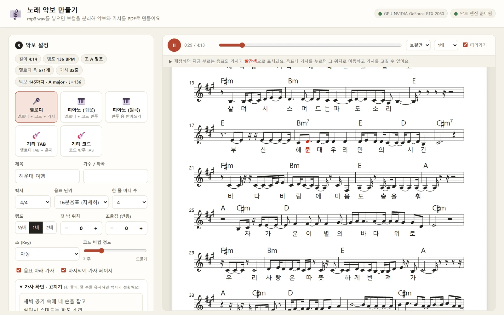
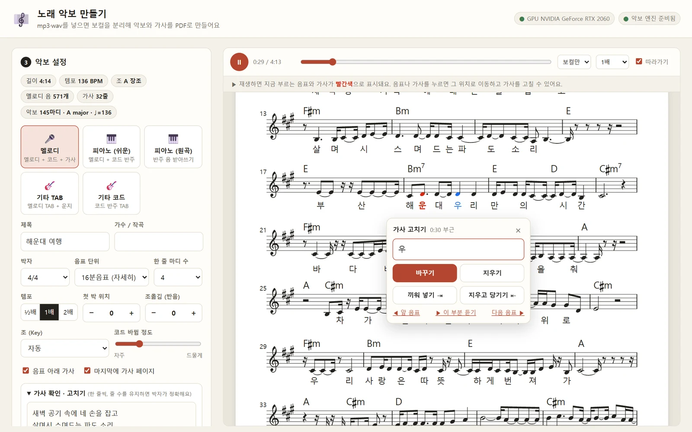
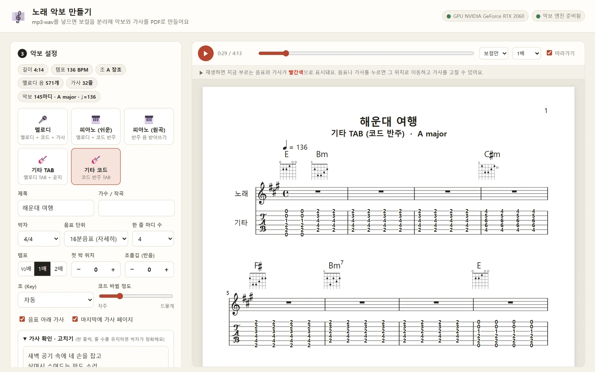

<p align="center"></p>

<h1 align="center">노래 악보 만들기 (Song to Score)</h1>

<p align="center">
mp3·wav 노래 파일을 넣으면 <b>보컬을 분리해 멜로디·코드·가사를 받아쓰고</b><br>
멜로디 악보 · 피아노 악보 · 기타 TAB 악보를 PDF로 만들어 주는 Windows 프로그램
</p>

<p align="center">
<a href="https://github.com/cybereun"></a>
<a href="https://github.com/cybereun/song-to-score/releases/latest"></a>
<a href="https://cybereun.github.io/song-to-score/"></a>
<a href="LICENSE"></a>
</p>

<p align="center"></p>

모든 분석은 **내 PC 안에서** 이루어지고, 음원은 외부로 전송되지 않습니다.

## 주요 기능

| 기능 | 설명 |
|---|---|
| 🎤 보컬 분리 | 노래를 보컬과 반주로 나눠, 반주에 묻히지 않은 멜로디와 가사를 뽑습니다 |
| 🎼 5가지 악보 | 멜로디(리드시트) · 피아노(쉬운 반주) · 피아노(반주 받아쓰기) · 기타 멜로디 TAB · 기타 코드 반주 TAB |
| 📝 가사 자동 배치 | 가사를 받아쓰고 음절마다 시간을 찾아 음표 아래에 한 글자씩 붙입니다 (한국어·영어·일본어·중국어) |
| 🎸 코드·운지표 | 반주에서 코드 진행을 찾아 코드 이름과 기타 운지표를 함께 그립니다 |
| ▶ 재생하며 확인 | 재생하면 지금 부르는 음표와 가사가 **빨간색**으로 표시되고 악보가 따라 넘어갑니다 (원곡·보컬만·반주만, 0.5배속 지원) |
| ✏️ 음표 눌러 가사 고치기 | 음표를 누르면 그 자리로 이동하고, 글자 바꾸기 · 지우기 · 끼워 넣기 · 당기기를 할 수 있습니다 |
| 🎚 손쉬운 보정 | 템포 ½배·2배, 첫 박 위치, 조옮김, 조, 박자, 음표 단위(8분/16분), 코드 바뀜 정도 |
| 💾 다양한 저장 | PDF(가사 페이지 포함) · MusicXML(MuseScore 편집용) · MIDI · 분리된 보컬/반주 wav |

<table>
<tr>
<td></td>
<td></td>
</tr>
<tr>
<td align="center">음표를 눌러 가사 고치기</td>
<td align="center">기타 코드 반주 TAB + 운지표</td>
</tr>
</table>

## 설치

### 1. 내려받기
[**최신 버전 내려받기 (Releases)**](https://github.com/cybereun/song-to-score/releases/latest) 에서 `SongToScore_Setup_<버전>.exe` (약 50MB)를 받습니다.

### 2. 설치하기
1. 받은 설치 파일을 실행합니다. Python 등을 따로 설치할 필요가 없고, 관리자 권한도 필요 없습니다.
   - 코드 서명이 없어서 "Windows의 PC 보호" 창이 뜨면 **「추가 정보」 → 「실행」** 을 누르세요.
2. 안내에 따라 「다음」을 누릅니다.
3. 설치 도중 검은 창이 열리며 분석 라이브러리(약 3.5GB)를 내려받습니다. **끝날 때까지 닫지 마세요** (인터넷 속도에 따라 2~15분).
   - NVIDIA 그래픽카드가 있으면 GPU 버전을 자동으로 설치합니다.
4. 바탕화면과 시작 메뉴에 「노래 악보 만들기」가 생깁니다.

> 처음 곡을 분석할 때 가사 인식·보컬 분리 모델(약 2GB)을 한 번 더 내려받습니다.

### 시스템 요구 사항
| 항목 | 권장 |
|---|---|
| 운영체제 | Windows 10 / 11 (64비트) |
| 디스크 | 여유 공간 약 8GB |
| 그래픽카드 | NVIDIA GPU (VRAM 4GB 이상) 권장. 없어도 동작하지만 한 곡에 10분 이상 걸릴 수 있어요 |
| 인터넷 | 설치할 때와 첫 분석 때만 필요 |

### 업데이트
v1.0.1부터는 프로그램을 열 때 새 버전이 있는지 자동으로 확인합니다. 새 버전이 있으면 안내 창이 뜨고, **「지금 업데이트하고 다시 시작」** 을 누르면 받아서 설치한 뒤 프로그램이 새 버전으로 다시 열립니다(약 1~3분). 작업한 악보와 설정은 그대로 남습니다.
오른쪽 위 ⚙ 설정 → 「업데이트」 에서도 직접 확인할 수 있습니다.

> **v1.0.0 사용자는 v1.0.1을 한 번 직접 받아 설치해 주세요.** v1.0.0에는 업데이트 확인 기능이 없고, 처음 분석할 때 가사 인식 단계(30%)에서 `Unable to open file 'model.bin'` 오류가 나는 문제가 있습니다. 덮어 설치하면 작업 파일은 그대로 남습니다.

### 제거
Windows 「설정 → 앱 → 설치된 앱」 에서 「노래 악보 만들기」를 제거합니다. 분석한 작업 파일과 AI 모델(`%LOCALAPPDATA%\SongToScore`)도 지울지 물어봅니다.
구성 요소 설치가 중간에 실패했다면 시작 메뉴의 「노래 악보 만들기 - 구성 요소 다시 설치」를 실행하세요.

## 사용법

1. **음원 넣기** — 「노래 악보 만들기」를 실행하고 mp3·wav·flac·m4a 파일을 창에 끌어다 놓습니다. 가사 언어를 고를 수 있어요.
2. **분석 기다리기** — 보컬 분리 → 가사 받아쓰기 → 멜로디 → 템포·코드 → 반주 음 순서로 진행됩니다 (GPU 기준 4분 곡에 2~3분).
3. **악보 종류 고르기** — 멜로디 / 피아노(쉬운) / 피아노(원곡) / 기타 TAB / 기타 코드 중에서 고르면 바로 다시 그려집니다.
4. **재생하며 확인하기** — 악보 위 ▶ 버튼(또는 스페이스 키)을 누르면 지금 부르는 음표와 가사가 빨간색으로 표시됩니다. 원곡 / 보컬만 / 반주만, 0.5배·0.75배 속도를 고를 수 있어요.
5. **틀린 곳 고치기**
   - **음표 누르기**: 음표나 가사를 누르면 작은 창이 열립니다.
     - 바꾸기(Enter): 이 음표의 글자를 바꾸고 다음 음표로
     - 지우기: 이 음표의 가사 없애기
     - 끼워 넣기: 여기에 새 글자를 넣고 뒤 가사를 한 음표씩 뒤로 밀기
     - 지우고 당기기: 이 글자를 지우고 뒤 가사를 한 음표씩 앞으로 당기기
   - **가사 전체 고치기**: 왼쪽 가사 칸에서 고친 뒤 「악보 만들기」. 줄을 합치거나 나누거나 빠진 줄을 써 넣어도 글자 순서에 맞춰 제자리를 찾아요.
   - **박자·조 보정**: 템포가 두 배/절반으로 잡혔으면 「½배 / 2배」, 마디가 한두 박 밀렸으면 「첫 박 위치」, 부르기 편한 키가 필요하면 「조옮김」.
   - **음표 단위**: 8분음표로 바꾸면 더 단순하고 읽기 쉬운 악보가 됩니다.
6. **저장·인쇄** — 「PDF 저장」, 「인쇄」, 「MusicXML」, 「MIDI」. 분리된 보컬·반주 wav도 저장할 수 있어요.
7. **설정(⚙)** — 오른쪽 위 톱니바퀴를 누르면 도움말, 업데이트 확인, 개발자 정보를 볼 수 있어요. 현재 버전은 제목 옆에 작게 표시됩니다.

> 자동 채보 결과는 **초안**입니다. 꾸밈음이 많은 창법·랩·화음 코러스는 손으로 다듬어야 할 수 있어요. 더 세밀한 편집은 MusicXML을 [MuseScore](https://musescore.org/)에서 열어 하면 편합니다.

## 처리 과정

```
음원 ─▶ ① Demucs 보컬 / 반주 분리
     ─▶ ② faster-whisper (Whisper large-v3-turbo) 가사 받아쓰기 + 단어별 시간
     ─▶ ③ torchcrepe 보컬 음높이 추적 → 음표 분할 (가사 음절 위치에서도 끊음)
     ─▶ ④ librosa 박 추적·템포, 반주 크로마로 조성·코드 추정
     ─▶ ⑤ Basic Pitch 반주 음 받아쓰기 (피아노 원곡 모드)
     ─▶ ⑥ 박 격자에 맞춰 정리 → LilyPond 조판 → SVG(화면) / PDF / MIDI,  music21 → MusicXML
```

## 개발자용

### 소스에서 실행
```powershell
설치.bat      # %USERPROFILE%\dev\song-to-score 에 가상환경·라이브러리·LilyPond 설치
실행.bat      # 프로그램 창으로 실행 (브라우저로 쓰려면: python server.py)
```

### 설치 파일 만들기
```powershell
powershell -ExecutionPolicy Bypass -File installer\build.ps1
```
필요한 것: [Inno Setup 6](https://jrsoftware.org/isinfo.php), `build\cache\python-embed.zip`(Python 3.12 임베디드), `build\cache\get-pip.py`, `build\cache\uv.exe`([uv](https://github.com/astral-sh/uv) 실행 파일), `tools\lilypond-2.24.4`. 결과물은 `dist\` 에 생깁니다.

### 폴더 구성
```
app.py               프로그램 창 (pywebview + Edge WebView2)
server.py            로컬 웹 서버 (FastAPI)
songscore/           분석·편곡·조판
  separate.py  lyrics.py  melody.py  rhythm.py  harmony.py  accomp.py
  arrange.py   lily.py    export.py  pipeline.py  config.py
  version.py   updater.py (버전 정보·자동 업데이트)
web/                 화면 (HTML·CSS·JS: app.js, player.js, update.js)
installer/           설치 파일 (Inno Setup 스크립트, 구성 요소 설치 스크립트, 오픈소스 안내)
docs/                홍보용 웹페이지 (GitHub Pages)
assets/              아이콘
```

## 저작권 · 개발자

### 개발자
| | |
|---|---|
| 개발자 | [@2026Lebi_Cybereun](https://www.threads.com/@lebi_cyber) (스레드) · GitHub [cybereun](https://github.com/cybereun) |
| 저장소 | https://github.com/cybereun/song-to-score |
| 홈페이지 | https://cybereun.github.io/song-to-score/ |

### 저작권과 라이선스
**© 2026 cybereun.** [MIT License](LICENSE)로 공개합니다.

이 프로그램의 소스 코드·화면 디자인·아이콘·문서의 저작권은 **cybereun**에게 있습니다.
누구나 MIT 라이선스에 따라 자유롭게 사용, 복사, 수정, 배포, 상업적 이용을 할 수 있지만, **복사본이나 수정본을 배포할 때는 위 저작권 표시(© 2026 cybereun)와 MIT 라이선스 전문을 반드시 그대로 남겨야 합니다.** 수정해서 배포한다면 원작자(cybereun)와 이 저장소 링크를 함께 밝혀 주세요.
소프트웨어는 어떤 보증도 없이 "있는 그대로" 제공됩니다. 악보로 만드는 음원의 저작권은 각 권리자에게 있으니, 저작권이 있는 곡은 개인 학습·연습 용도로만 사용해 주세요.

### 사용한 오픈소스 기술과 저작권
이 프로그램은 아래 오픈소스 소프트웨어와 모델을 사용합니다. 각 구성 요소의 저작권은 해당 저작자에게 있으며 **각자의 라이선스를 따르고, 위 MIT 라이선스는 이들에 적용되지 않습니다.**

**설치 파일에 함께 들어 있는 것**

| 구성 요소 | 용도 | 라이선스 | 저작권 |
|---|---|---|---|
| [GNU LilyPond](https://lilypond.org/) 2.24.4 | 악보 조판 (PDF·SVG·MIDI) | GPL-3.0-or-later | © LilyPond 개발자들. 수정하지 않은 공식 배포본을 별도 실행 파일로 사용하며, 원본 소스는 [gitlab.com/lilypond/lilypond](https://gitlab.com/lilypond/lilypond)에서 받을 수 있습니다. 함께 들어 있는 라이브러리(Ghostscript, Guile, Pango, Cairo, FreeType 등) 라이선스는 설치 폴더 `tools\lilypond-2.24.4\licenses` 에 있습니다 |
| [Python](https://www.python.org/) 3.12 (임베디드) | 실행 환경 | PSF License 2.0 | © Python Software Foundation |
| [uv](https://github.com/astral-sh/uv) | 구성 요소 빠른 설치 | MIT 또는 Apache-2.0 | © Astral Software Inc. |

**설치 중에 내려받는 것**

| 구성 요소 | 용도 | 라이선스 | 저작권 |
|---|---|---|---|
| [PyTorch](https://pytorch.org/) / torchaudio | AI 모델 실행 | BSD-3-Clause | © Meta Platforms, Inc. 및 기여자 |
| [Demucs](https://github.com/adefossez/demucs) (htdemucs 모델 포함) | 보컬 / 반주 분리 | MIT | © Meta Platforms, Inc. |
| [faster-whisper](https://github.com/SYSTRAN/faster-whisper) | 가사 받아쓰기 | MIT | © SYSTRAN |
| [CTranslate2](https://github.com/OpenNMT/CTranslate2) | Whisper 실행 엔진 | MIT | © SYSTRAN / OpenNMT |
| [Whisper large-v3-turbo](https://huggingface.co/openai/whisper-large-v3-turbo) 모델 | 음성 인식 모델 | MIT | © OpenAI |
| [torchcrepe](https://github.com/maxrmorrison/torchcrepe) (CREPE 모델) | 보컬 음높이 추적 | MIT | © Max Morrison / CREPE: Jong Wook Kim 외 |
| [Basic Pitch](https://github.com/spotify/basic-pitch) | 반주 음 받아쓰기 | Apache-2.0 | © Spotify AB |
| [librosa](https://librosa.org/) | 템포·박·크로마 분석 | ISC | © librosa 개발팀 |
| [music21](https://web.mit.edu/music21/) | MusicXML 만들기 | BSD-3-Clause | © Michael Scott Asato Cuthbert 및 기여자 |
| [pretty_midi](https://github.com/craffel/pretty-midi) / [mir_eval](https://github.com/craffel/mir_eval) | MIDI·음악 정보 처리 | MIT | © Colin Raffel 외 |
| [NumPy](https://numpy.org/) / [SciPy](https://scipy.org/) / [scikit-learn](https://scikit-learn.org/) | 수치 계산 | BSD-3-Clause | © 각 프로젝트 개발자 |
| [ONNX Runtime](https://onnxruntime.ai/) | Basic Pitch 모델 실행 | MIT | © Microsoft Corporation |
| [python-soundfile](https://github.com/bastibe/python-soundfile) / libsndfile | 오디오 파일 읽기·쓰기 | BSD-3-Clause / LGPL-2.1 | © Bastian Bechtold / Erik de Castro Lopo |
| [FastAPI](https://fastapi.tiangolo.com/) / [Starlette](https://www.starlette.io/) / [Uvicorn](https://www.uvicorn.org/) | 로컬 서버 | MIT / BSD-3-Clause / BSD-3-Clause | © Sebastián Ramírez / Encode OSS Ltd. |
| [pywebview](https://pywebview.flowrl.com/) / [pythonnet](https://github.com/pythonnet/pythonnet) | 프로그램 창 | BSD-3-Clause / MIT | © Roman Sirokov / .NET Foundation |

**만들거나 실행할 때 쓰는 도구**

| 구성 요소 | 용도 | 라이선스 |
|---|---|---|
| [Inno Setup](https://jrsoftware.org/isinfo.php) 6 | 설치 파일 제작 | Inno Setup License (© Jordan Russell, Martijn Laan) |
| [Microsoft Edge WebView2 Runtime](https://developer.microsoft.com/microsoft-edge/webview2/) | 프로그램 창 화면 표시 (Windows 기본 포함) | Microsoft 소프트웨어 사용 조건 |

설치된 각 Python 패키지의 라이선스 전문은 설치 폴더의 `python\Lib\site-packages\<패키지>-<버전>.dist-info` 안에 있고, 요약은 [`installer/THIRD_PARTY_NOTICES.txt`](installer/THIRD_PARTY_NOTICES.txt)에 있습니다.
